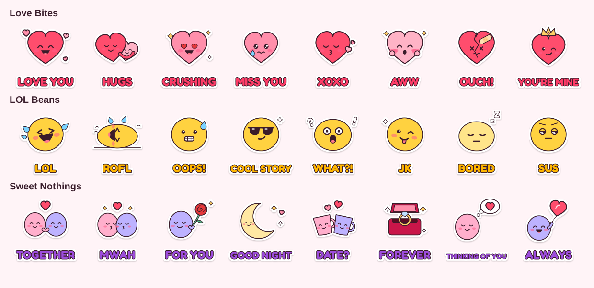

# Love Comedy Romance Stickers

An Android app that adds three original sticker packs to WhatsApp and WhatsApp Business.



| Pack | Theme | Stickers |
| --- | --- | --- |
| **Love Bites** | Cute hearts | Love You, Hugs, Crushing, Miss You, XOXO, Aww, Ouch!, You're Mine |
| **LOL Beans** | Comedy | LOL, ROFL, Oops!, Cool Story, What?!, JK, Bored, Sus |
| **Sweet Nothings** | Romance | Together, Mwah, For You, Good Night, Date?, Forever, Thinking of You, Always |

## How it works

- The home screen lists the packs. Tap **Add** to send a pack to WhatsApp, or tap a pack to see every sticker.
- The app works out whether each pack is already in WhatsApp and shows **Added ✓** when it is.
- WhatsApp reads the stickers through `StickerContentProvider`, using the URI layout and column names that WhatsApp expects.
- Every sticker is a 512×512 WebP with a transparent background, under 100 KB. Every pack has a 96×96 tray icon, 1–3 emojis per sticker and accessibility text, as WhatsApp requires.

## Build and run

1. Open the project in Android Studio, or build from the command line:

   ```bash
   ./gradlew assembleDebug
   ```

2. Install `app/build/outputs/apk/debug/app-debug.apk` on a phone that has WhatsApp.

Every push also runs the GitHub Actions workflow in `.github/workflows/build.yml`. It checks the stickers, builds the debug APK and uploads it as a downloadable artifact.

## Project layout

```
app/src/main/
  assets/contents.json        pack catalogue (names, files, emojis)
  assets/<pack>/              sticker .webp files and tray.png
  java/.../StickerContentProvider.kt   what WhatsApp reads
  java/.../WhatsApp.kt        "already added?" check and the add-pack intent
  java/.../MainActivity.kt    pack list
  java/.../PackDetailActivity.kt  sticker grid for one pack
tools/sticker-gen/            the sticker artwork and the scripts that render it
```

## Changing the stickers

The artwork is drawn in code in `tools/sticker-gen/art.js`, so you can edit a caption, colour or face and regenerate the files:

```bash
cd tools/sticker-gen && npm install && npx playwright install chromium && npm run generate && npm run validate
```

`generate` rewrites the files in `app/src/main/assets`, including `contents.json`, and `docs/preview.png`. `validate` checks them against WhatsApp's limits. It needs Node 18 or newer.

To use your own images instead, put them in `app/src/main/assets/<pack>/`, list them in `contents.json` and run `npm run validate`.

## Before publishing to Google Play

- Change `applicationId` in `app/build.gradle.kts` to an ID you own.
- Add the Play Store link to `android_play_store_link` in `contents.json`.
- If you change a sticker after release, bump that pack's `version` in `art.js` (it becomes `image_data_version` in `contents.json`) so WhatsApp refreshes it.
- Set up a release signing key, and raise `targetSdk` to whatever Google Play currently requires.

## Credits

The sticker artwork is original. Captions use the [Fredoka](https://fonts.google.com/specimen/Fredoka) font (SIL Open Font License).
